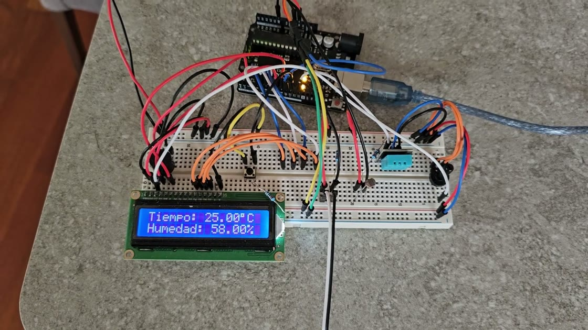
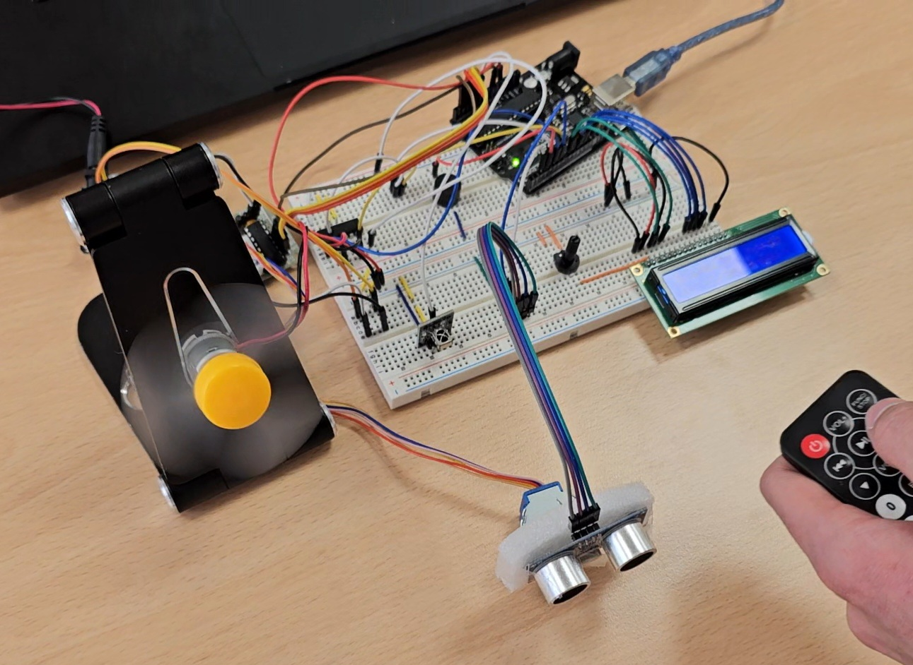
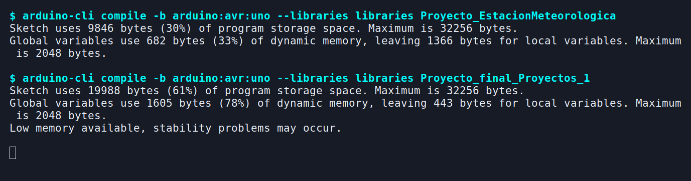

# Arduino Uno Projects

Two embedded systems built for U-tad Projects I in 2023–24. The weather station reads its surroundings and operates a model awning. The final project combines a fan that responds to presence with a clock and three alarms.

## Weather station with a model awning



The DHT11 measures temperature and humidity, and a photoresistor provides a relative light reading. A tilt switch serves as the wind input. The sketch tracks recent switch activity over a five-second window and uses it to trigger the servo and buzzer. A push button cycles the LCD through readings, wind status and a cloudiness estimate based on light.

| Device | Arduino Uno pins |
| --- | --- |
| DHT11 | D13 |
| Photoresistor | A0 |
| Tilt switch | D12 |
| Mode button | D11 |
| Servo and buzzer | D10 and D2 |
| LCD 16×2 | RS D8, EN D9, data D4–D7 |

[Weather station sketch](Proyecto_EstacionMeteorologica/Proyecto_EstacionMeteorologica.ino) · [Breadboard wiring](docs/media/weather-station-wiring.png)

## Presence-aware fan with clock and alarms



- **Automatic fan control.** An ultrasonic sensor detects objects within a configurable range. A stepper motor can sweep the sensor across the area. The fan switches off after a configurable delay without detection.
- **Manual control.** The infrared remote navigates the LCD menus and sets the DC fan's speed and direction through an H-bridge.
- **Clock and alarms.** The software clock advances in the background. The serial console sets the date and time, and the buzzer signals any of the three enabled alarms.
- **Persistence.** A remote command saves a snapshot of the clock, alarms and fan settings in EEPROM for the next startup.

Final project by Jorge Matesanz and Juan Sotos. [Fan controller sketch](Proyecto_final_Proyectos_1/Proyecto_final_Proyectos_1.ino) · [Circuit view](docs/media/smart-fan-wiring.png)

## Build for Arduino Uno

From the repository root, install the AVR core and the display and servo libraries. The repository includes the DHT, Adafruit Unified Sensor and IRremote libraries under `libraries/`. EEPROM is part of the AVR core.

```sh
arduino-cli core install arduino:avr
arduino-cli lib install LiquidCrystal Servo

arduino-cli compile --fqbn arduino:avr:uno --libraries libraries Proyecto_EstacionMeteorologica
arduino-cli compile --fqbn arduino:avr:uno --libraries libraries Proyecto_final_Proyectos_1
```



Both sketches use a 9600 baud serial monitor.

## Other sketches

- [Air controller](Controlador_aire/Controlador_aire.ino) and [low-power variant](Controlador_aire_LPower/Controlador_aire_LPower.ino).
- [Adder for Computer Architecture](Codigo_Arduino_Sumador_Arq_Ord/Codigo_Arduino_Sumador_Arq_Ord.ino).

The vendored libraries carry their own licenses in [libraries](libraries/).
